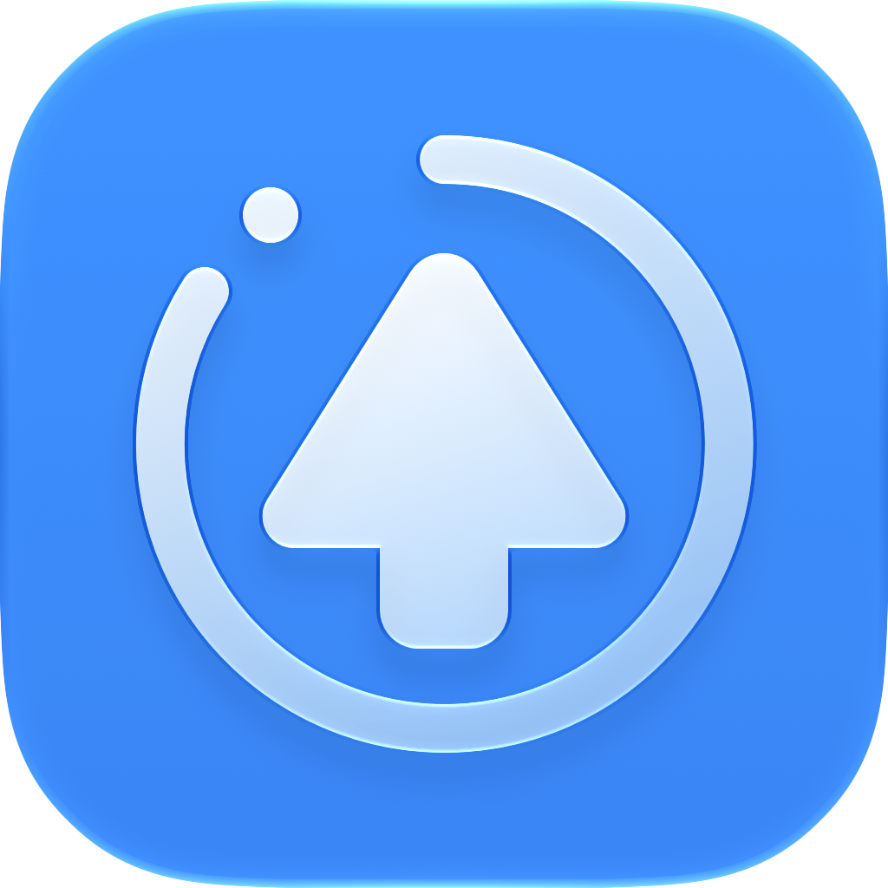
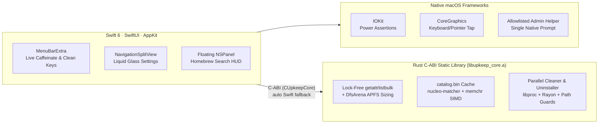

<div align="center">



# Upkeep

**A fast, native macOS menu-bar toolkit for power control, Homebrew management, deep disk cleaning, and complete app uninstallation.**

<p>
  <a href="https://github.com/manavo-o/Upkeep/releases/latest">
    
  </a>
  
  
  
  <a href="https://github.com/manavo-o/Upkeep/actions/workflows/release.yml">
    
  </a>
</p>

<p>
  <a href="#features-at-a-glance">Features</a> •
  <a href="#inside-upkeep">Deep Dive</a> •
  <a href="#safety--protection-model">Safety</a> •
  <a href="#architecture">Architecture</a> •
  <a href="#installation">Install</a> •
  <a href="#keyboard-shortcuts">Shortcuts</a> •
  <a href="#privacy--network-activity">Privacy</a> •
  <a href="#faq">FAQ</a>
</p>

</div>

Upkeep replaces a drawer of single-purpose utilities with one quiet macOS menu-bar app that opens into a native **Liquid Glass** workspace modeled on System Settings. Everything runs locally with **zero third-party cleaner dependencies**: a Swift 6 / SwiftUI / AppKit interface paired with a static Rust engine (`libupkeep_core.a`) for APFS-accurate disk sizing, sub-millisecond fuzzy search, parallel cache cleaning, and deep app leftover discovery.

> [!IMPORTANT]
> **Review before anything is deleted.** Both the Cleaner and Uninstaller preview every path with APFS-accurate sizes, checkboxes, **Reveal in Finder** links, amber `Held back` pills for personal or active data, and purple `Admin` pills for opt-in system items.

---

## Features at a Glance

| Module | What It Does | Under the Hood |
| --- | --- | --- |
| **Power & Input** | Keep your Mac awake (**Caffeinate**) and lock keyboard/trackpad input while wiping your MacBook (**Clean Keys**). | Native IOKit power assertions, CoreGraphics event tap, jitter-free monospaced menu countdown. |
| **Homebrew** | Floating Liquid Glass **Search HUD** + unified Settings downloader across ~15,000 formulae and casks with live streaming logs. | Versioned `catalog.bin` cache (`<5 ms` cold start), `ETag` `304` revalidation, 5-tier `nucleo-matcher` + `memchr` SIMD ranking. |
| **Cleaner** | Interactive parallel cleanup across **12 categories** — 64+ developer/AI/ML caches, browsers, Electron apps, containers, build artifacts, orphans, installers, and opt-in Admin caches. | Lock-free `getattrlistbulk` + `DfsArena` APFS sizing, `libproc` + `SingletonLock` live-app guards, Rayon parallelism. |
| **Uninstaller** | Complete app removal with deep leftover inspection, opt-in Admin system cleanup, Homebrew `--zap`, sibling-app protection, and personal-data holdbacks. | `<15 ms` two-phase app scan, UUID-filtered container metadata (5×–10× faster), `launchctl bootout` + `lsregister -u`. |
| **Updates & Diagnostics** | Built-in GitHub Releases auto-updater, `brew update` runner, Accessibility permission checks, and `⌘F` settings search. | Direct GitHub Releases API check (`manavo-o/Upkeep`), zero telemetry. |

## Inside Upkeep

### Power & Input
- **Caffeinate (Keep Mac Awake)**: Creates native macOS IOKit power assertions (`IOPMAssertionCreateWithName`) with no background subprocesses. Switch between **Display & System** and **System Only**, start with quick presets (`30m`, `1h`, `2h`, `Indefinite`), extend by `+30m` in one click, and follow the remaining time with a live monospaced-digit countdown in the menu bar that stays rock-solid while hovering submenus.
- **Clean Keys (Keyboard & Pointer Lock)**: Uses a CoreGraphics event tap (`CGEvent.tapCreate`) to absorb accidental keystrokes and optional trackpad/pointer input while cleaning your MacBook. Includes presets (`30s`, `60s`, `2m`), **Dim Screen While Locked**, and two hardware-safe emergency exits: **hold <kbd>⌘</kbd> + <kbd>Esc</kbd> for 1 second** or **press <kbd>⌘</kbd> six times**.

### Homebrew Search HUD & Package Manager
- **Instant Binary Catalog (`<5 ms` startup)**: Stores Homebrew's ~15,000 `formula.json` and `cask.json` entries in a compact versioned binary cache (`catalog.bin`), revalidates quietly over HTTP `ETag` (`304 Not Modified`), and merges local `Cellar`/`Caskroom`/pinned state directly from disk in ~5 ms without invoking Ruby.
- **5-Tier Name-First Search**: Ranks results in **Exact → Prefix → Substring → Fuzzy Name → Description** order using `nucleo-matcher` and `memchr` NEON/SIMD scanning, shared between the floating Liquid Glass Search HUD and the Settings **Homebrew** pane.
- **Full Package Lifecycle**: Switch scopes (`Installed`, `Formulae`, `Casks`, `Upgrades`), trigger <kbd>⌘</kbd><kbd>K</kbd> actions (**Install**, **Upgrade**, **Pin / Unpin**, **Uninstall**, **Homepage**), and watch coalesced live output from `brew install`, `brew upgrade`, `brew uninstall`, and `brew doctor`.

### Native Rust Cleaner (12 Categories)
Built directly into `upkeep_core` using `getattrlistbulk`, `O_NOFOLLOW`, and Rayon parallelism with full Mole v1.74 cleanup parity and zero external CLI dependencies.

<details>
<summary><strong>Explore all 12 cleanup categories (64+ developer targets, browser clones, project artifacts & opt-in Admin caches)</strong></summary>

1. **Developer Tools (64+ targets + shut-down Simulators)** — Xcode (`DerivedData`, Caches, `XCTest`, Products, iOS Device Logs, SwiftUI Previews; held-back Archives & iOS/watchOS/tvOS DeviceSupport), CoreSimulator (`Caches`, user `dyld`, and shut-down per-device `data/{tmp,Library/Caches,Library/Logs}` when Simulator isn't running), Homebrew, SwiftPM, CocoaPods, JetBrains, Android Studio, Docker Buildx, npm (`_cacache`, `_logs`), pnpm, Yarn Classic, Bun, `node-gyp`, Electron, Deno, TypeScript, Turborepo, esbuild, Biome, Prisma, pip, uv, Poetry, Pipenv, Conda, Ruff, Mypy, `pre-commit`, Cargo (`cache` & `src`), Rustup downloads, Bazel, Zig, `sccache`, `ccache`, Gradle, Android cache/build-cache, Ivy2, Coursier, Maven (held back), Go build cache, Playwright & Puppeteer browsers (held back), Composer, RubyGems, `pyenv`, `nvm`, Hugging Face Hub (held back), NuGet (held back), and Dart/Flutter Pub Cache (held back).
2. **Browser Caches** — Chrome, Brave, Edge, Arc, Firefox, Zen, Vivaldi, Opera, plus Chromium `.code_sign_clone` update leftovers (Chrome, Brave, Edge, Helium) in `~/Library/Caches` and `$TMPDIR`. **Caches only** — never touches profiles, bookmarks, history, cookies, passwords, or sessions.
3. **App Internal Caches** — Exact disposable Electron/Chromium cache leaves (`Cache`, `Code Cache`, `GPUCache`, `DawnCache`, `DawnGraphiteCache`, `DawnWebGPUCache`, `CachedData`, `Service Worker/CacheStorage`, `Crashpad/completed`) in `~/Library/Application Support/<App>/`, plus Vesktop `sessionData`, T3 Code preview partitions, and Adobe Media Cache.
4. **User App & Sandboxed Container Caches** — `~/Library/Caches/*` and third-party `~/Library/Containers/<bundle_id>/Data/Library/Caches` (preserving parent directories).
5. **macOS & Apple Caches** — QuickLook thumbnails & cache, Icon Services, Safari Webpage Previews, WebKit Network cache, App Store caches, Media/Photo Analysis, Siri/Calendar/Address Book/Help Viewer caches, Apple Maps `GeoServices`, Messages sticker/preview caches (never `Attachments`), 30d+ Mail Downloads attachment copies (held back), Autosave Information (held back), and local iOS Device Backups (held back).
6. **Project Build Artifacts** — Bounded, sibling-marker-verified discovery of rebuildable `node_modules`, `target`, `.build`, `Pods`, `.venv`, `venv`, `__pycache__`, `.pytest_cache`, `.mypy_cache`, `.ruff_cache`, `.next`, `.nuxt`, `.svelte-kit`, `.turbo`, `.parcel-cache`, `.gradle`, `.dart_tool`, `dist`, and `build` folders across standard developer roots (`~/Projects`, `~/Developer`, `~/Code`, `~/GitHub`, `~/dev`, `~/.t3/worktrees`, etc.) with nested `.git` protection and 7-day activity badges (held back by default).
7. **Orphaned App Leftovers** — 30d+ deep-stale caches, logs, `HTTPStorages`, `WebKit`, and saved states whose reverse-DNS bundle ID is no longer installed across `/Applications`, `/System/Applications`, `~/Applications`, Setapp, or Homebrew Caskroom, plus orphaned non-Apple `/Library/LaunchDaemons` & `/Library/LaunchAgents` whose target binaries no longer exist (`Admin`).
8. **Logs & Diagnostics** — `~/Library/Logs`, `DiagnosticReports`, and 30d+ `CrashReporter` entries.
9. **Saved State & Temp** — `Saved Application State` (held back), user-owned `$TMPDIR` files >24h old, and stale `.crdownload` / `.download` / `.part` files >24h old (held back).
10. **Old Installers** — `.dmg`, `.pkg`, `.mpkg`, `.iso`, and `.xip` files older than 24h in `~/Downloads` and `~/Desktop` (held back).
11. **System Caches & Logs (Admin)** — Opt-in allowlisted system cleanup (`/Library/Developer/CoreSimulator/Caches/dyld`, `/Library/Logs/DiagnosticReports`, `/private/var/db/diagnostics/{Special,Persist}`, `/private/var/db/DiagnosticPipeline`, `/private/var/db/reportmemoryexception`, stale `/private/var/log`, `/Library/Caches`, `/private/tmp`, `/private/var/tmp`, and `/private/var/db/powerlog` excluding live `Current*` PerfPowerTelemetry databases). Only prompts for an administrator password when you explicitly select Admin items.
12. **Trash** — `~/.Trash` (held back by default).

</details>

### Deep App Uninstaller
- **Two-Phase Discovery (`<15 ms` first paint)**: Scans `/Applications`, `~/Applications`, and 1-level subfolders (Setapp, Utilities, Adobe), reading `CFBundleName` and `CFBundleDisplayName` before filling APFS-accurate sizes concurrently.
- **Opt-In Admin System Leftovers**: System remnants (`/Library/LaunchDaemons`, `/Library/LaunchAgents`, `/Library/PrivilegedHelperTools`, `/Library/Application Support`, `/Library/Caches`, `/Library/Logs`, `/Library/Preferences`, `/Users/Shared`, `/private/var/db/receipts`) appear with purple `Admin` badges, validate against a strict allowlist, unload cleanly via `launchctl bootout system`, and run `lsregister -u` on the removed bundle.
- **Homebrew Caskroom Integration**: Automatically detects Caskroom-managed apps and offers `brew uninstall --cask --zap <token>` — skipping `--zap` whenever a sibling channel is co-installed.

<details>
<summary><strong>Explore all Uninstaller leftover discovery surfaces</strong></summary>

- **Standard macOS User Locations**: `Application Support`, `Caches`, `Preferences`, `ByHost`, `SyncedPreferences`, `Logs`, `Containers`, UUID sandbox containers (`MCMMetadataIdentifier` with 36-char UUID pre-filtering), `Group Containers` (`<TeamID>.` boundary matching), `HTTPStorages`, `WebKit`, `Cookies`, `Saved Application State`, `Autosave Information`, `FileProvider`, `ApplicationRecentDocuments` (`.sfl2`–`.sfl4`), and `SplashBoard/Snapshots`.
- **Helpers, Agents & Crash Telemetry**: Embedded `.appex`, `.xpc`, `LoginItems`, `Contents/Preferences`, `SharedSupport`, `QuickLook`, and `Spotlight` bundle IDs; `LaunchAgents` (`Program`/`ProgramArguments[0]` ownership matching + `launchctl bootout`); `ShipIt`/updaters; `KSCrash`, `SentryCrash`, `CrashReporter`, `DiagnosticReports`; `NativeMessagingHosts`; plug-ins; XDG directories; vendor-nested folders; and tailored rules for VS Code, Xcode, JetBrains, Android Studio, Claude Desktop, Docker, Anki, and Godot.

</details>

## Safety & Protection Model

Disk cleaners and uninstallers earn trust by what they **refuse** to touch. Upkeep enforces safety at the Rust engine level before any path is queued or deleted:

| Risk | How Upkeep Protects You |
| --- | --- |
| **Corrupting open app databases** | Enumerates live `.app` bundles via macOS `libproc` (`proc_listallpids` + `proc_pidpath`) and inspects Chromium/Electron `SingletonLock` PIDs to automatically hold back caches of running apps and browsers. |
| **Symlink escapes & path traversal** | Canonicalizes targets against user-home/temp allowlists (and a separate strict allowlist for Admin paths), rejects `..`, control characters, leaf symlinks, and symlinked ancestors, deduplicates by `(dev, ino)`, and preserves parent cache folders. |
| **Deleting credentials or irreplaceable data** | Permanently blocks Keychains, `.ssh`/`.gnupg`/`.aws`/`.kube`, independent CLI directories (Claude Code, Codex, Gemini, OpenCode), `llama.cpp`, `Buzz`, Yarn Berry stores, Jupyter runtime, macOS aerial wallpapers, OrbStack/Docker/UTM/Parallels/Tailscale state, Mail stores, Messages attachments, Apple Notes, Steam, Epic, Unity, and live `Current*` powerlogs. |
| **Breaking sibling apps or personal profiles** | Holds back browser profiles, `Group Containers`, VM/game libraries, Raycast clipboard cache, Mullvad Browser cache, and Spotify offline data unchecked by default; skips shared data and `--zap` when sibling channels exist (e.g., *VS Code* + *VS Code Insiders*). |
| **Removing managed security / MDM tools** | Flags enterprise MDM, endpoint security, and VPN suites (CrowdStrike, Jamf, SentinelOne, ESET, GlobalProtect, Cisco Secure Client, Malwarebytes, TeamViewer) and recommends their official vendor uninstallers. |

## Architecture



### Project Layout

```text
Upkeep/
├── Sources/
│   ├── Upkeep/
│   │   ├── App/           # Entry coordinator & floating HUD lifecycle
│   │   ├── Services/      # KeepAwake, CleaningMode, Brew, Mole/Cleaner, Updater, Engine
│   │   └── UI/            # Liquid Glass Settings, MenuBarExtra, Homebrew HUD, Search
│   ├── UpkeepAppEntry/    # Executable entrypoint
│   └── UpkeepSelfTest/    # Swift integration & regression self-test runner
├── rust/upkeep_core/      # Rust C-ABI engine (lib.rs, cleaner.rs, Cargo.toml)
├── Scripts/               # build-app.sh (Swift + Rust + vtool + signing), build-rust-cabi.sh
├── Resources/Icons/       # AppIcon.icns, AppIcon.png, Apple Icon Composer Upkeep.icon
└── .github/workflows/     # Automated macOS release builds & GitHub Releases publishing
```

## Installation

### Download a Release
1. Download the latest `Upkeep-v*.zip` from [**GitHub Releases**](https://github.com/manavo-o/Upkeep/releases/latest).
2. Unzip and move `Upkeep.app` into `/Applications`.
3. Launch **Upkeep** — it runs quietly from the top menu bar.

### Build from Source

**Prerequisites**
- **macOS 26.0+** (Liquid Glass UI; Swift package minimum deployment target macOS 15)
- **Swift 6** / Xcode Command Line Tools (`xcode-select --install`)
- **Rust (`cargo`)** *(recommended)* — compiled automatically into `Frameworks/lib/libupkeep_core.a` by `Scripts/build-app.sh`
- **Homebrew** *(optional)* — enables the Homebrew Search HUD and Caskroom integration

**Test, Build, Sign & Launch**

```zsh
git clone [https://github.com/manavo-o/Upkeep.git](https://github.com/manavo-o/Upkeep.git)
cd Upkeep
(cd rust/upkeep_core && cargo test) && ./Scripts/build-app.sh && open dist/Upkeep.app
```

**Run the Swift Self-Test Suite**

```zsh
./.build/release/UpkeepSelfTest
```

> [!TIP]
> Run `./Scripts/build-app.sh` in Terminal so it can sign `dist/Upkeep.app` with your `Apple Development` identity (or create a persistent local `Upkeep Local Signing` certificate). Persistent signing preserves your macOS Accessibility permission across rebuilds.

### Permissions
- **Accessibility** *(Clean Keys only)*: Open **Upkeep → Power & Input** (or **Updates**) and click **Grant Accessibility…** to enable Upkeep in **System Settings → Privacy & Security → Accessibility**.
- **Administrator Password** *(optional)*: Never requested during normal cache cleans or standard app uninstalls; macOS prompts once only when you explicitly check purple `Admin` items.

## Keyboard Shortcuts

| Context | Shortcut | Action |
| --- | --- | --- |
| **Main Window** | <kbd>⌘</kbd> <kbd>F</kbd> | Focus sidebar settings search |
| **Menu Bar** | <kbd>⌘</kbd> <kbd>,</kbd> | Open Upkeep window |
| **Menu Bar** | <kbd>⌘</kbd> <kbd>Q</kbd> | Quit Upkeep |
| **Homebrew HUD** | <kbd>⌘</kbd> <kbd>1</kbd> – <kbd>⌘</kbd> <kbd>4</kbd> | Switch scopes (Installed, Formulae, Casks, Upgrades) |
| **Homebrew HUD** | <kbd>⌘</kbd> <kbd>K</kbd> | Open package actions menu |
| **Homebrew HUD** | <kbd>Esc</kbd> | Dismiss Search HUD |
| **Clean Keys** | Hold <kbd>⌘</kbd> + <kbd>Esc</kbd> (1s) | Emergency unlock keyboard |
| **Clean Keys** | Press <kbd>⌘</kbd> × 6 | Alternate emergency unlock |

## Privacy & Network Activity

Upkeep runs **100% locally** with zero telemetry, zero analytics, and zero background daemons. The only outbound network requests Upkeep makes are:

- `https://formulae.brew.sh/api/formula.json` & `cask.json` — refreshes the local Homebrew catalog index (using HTTP `ETag` / `304 Not Modified`).
- `https://api.github.com/repos/manavo-o/Upkeep/releases/latest` — checks for new Upkeep releases when you check for updates.

## FAQ

<details>
<summary><strong>Why does Upkeep require macOS 26+?</strong></summary>

Upkeep is built around macOS 26/27 Liquid Glass materials, `NSGlassEffectView`, and native System Settings controls. `Scripts/build-app.sh` also stamps the real macOS SDK version into `LC_BUILD_VERSION` via `vtool` so SwiftPM builds render native Liquid Glass controls properly.
</details>

<details>
<summary><strong>Do I need Mole (<code>mo</code>) or Homebrew installed to use Upkeep?</strong></summary>

No. The Cleaner and Uninstaller run natively inside Upkeep's built-in Rust core with zero external CLI dependencies. Homebrew is completely optional — if it isn't installed, Power & Input, Cleaner, and Uninstaller still work in full, and the Homebrew pane offers a one-click install command.
</details>

<details>
<summary><strong>Can I build Upkeep without Rust installed?</strong></summary>

Yes. `Package.swift` automatically detects whether `Frameworks/lib/libupkeep_core.a` is present and falls back to Swift implementations when `cargo` isn't available. Building with Rust is recommended for full APFS `getattrlistbulk` speed, `catalog.bin` caching, and parallel scanning.
</details>

---

<div align="center">
  <a href="RELEASE_NOTES.md">Release Notes</a> •
  <a href="https://github.com/manavo-o/Upkeep/releases">Releases</a> •
  <a href="https://github.com/manavo-o/Upkeep/issues">Report an Issue</a> •
  <a href="#upkeep">Back to Top ↑</a>
</div>
