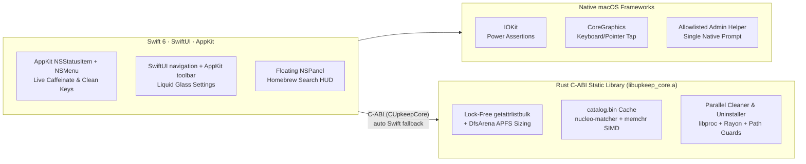

<div align="center">


# Upkeep

**A fast, native macOS menu-bar toolkit for power control, Homebrew management, disk cleanup, and app removal.**

<p>
  <a href="https://github.com/manavo-o/Upkeep/releases/latest">
    
  </a>
  
  
  
  
  <a href="https://github.com/manavo-o/Upkeep/actions/workflows/release.yml">
    
  </a>
</p>

<p>
  <a href="#features-at-a-glance">Features</a> •
  <a href="#inside-upkeep">Deep Dive</a> •
  <a href="#safety--protection-model">Safety</a> •
  <a href="#architecture">Architecture</a> •
  <a href="#installation">Install</a> •
  <a href="#keyboard-shortcuts">Shortcuts</a> •
  <a href="#privacy--network-activity">Privacy</a> •
  <a href="#faq">FAQ</a>
</p>

</div>

Upkeep opens from the menu bar into a native **Liquid Glass** workspace with grouped settings, Back and Forward navigation, and keyboard search. Its SwiftUI and AppKit interface uses a bundled Rust engine (`libupkeep_core.a`) for disk sizing, Homebrew catalog search, cache cleanup, and app leftover discovery.

> [!IMPORTANT]
> **Review what will be removed.** Cleaner shows detected files, estimated sizes, and the selected total before deletion. Uninstaller lets you review the app and select related files. Both show holdback reasons and identify items that require administrator access. In Cleaner, a blue **Running** badge marks app caches held back by the scan.

---

## Features at a Glance

| Module | What It Does | Under the Hood |
| --- | --- | --- |
| **Caffeinate & Clean Keys** | Keep your Mac awake (**Caffeinate**) and lock keyboard/trackpad input while wiping your MacBook (**Clean Keys**). | Native IOKit power assertions, CoreGraphics event tap, live monospaced menu countdown. |
| **Homebrew** | Search, install, and upgrade formulae and casks from Settings or the floating **Search HUD**. Follow command output in Homebrew Activity. | On-disk `catalog.bin` cache, HTTP revalidation, and ranked local search. |
| **Cleaner** | Review up to **12 categories** covering developer tools, browsers, app caches, build artifacts, installers, and opt-in system files. | Lock-free `getattrlistbulk` + `DfsArena` APFS sizing, `libproc` + `SingletonLock` live-app guards, Rayon parallelism. |
| **Uninstaller** | Review installed apps and related files, with optional administrator cleanup, Homebrew cask removal, and shared-data protection. | Two-phase app discovery and sizing, container metadata matching, and targeted service cleanup. |
| **General & About** | Interface preferences, keyboard shortcuts, version, app updates, and Accessibility status. | Toolbar search jumps to matching settings. App updates check the configured GitHub repository. |

## Inside Upkeep

### Caffeinate & Clean Keys
- **Caffeinate (Keep Mac Awake)**: Uses macOS power assertions to prevent idle sleep. Choose **Mac & Display** or **Mac Only**, start a timed session or choose **Until Stopped**, and add 30 minutes when needed. The countdown updates while the menu is open and when the Mac wakes.
- **Clean Keys (Keyboard & Pointer Lock)**: Uses a CoreGraphics event tap (`CGEvent.tapCreate`) to absorb accidental keystrokes and optional trackpad/pointer input while cleaning your MacBook. Includes presets (`30s`, `60s`, `2m`), **Dim Screen**, and two ways to unlock early: **hold <kbd>⌘</kbd> + <kbd>Esc</kbd> for 1 second** or **press <kbd>⌘</kbd> six times**.

### Homebrew Search HUD & Package Manager
- **Local package catalog** stores Homebrew formulae and casks in `catalog.bin`, refreshes the index using HTTP revalidation, and reads installed and pinned state from disk.
- **5-Tier Name-First Search**: Ranks results in **Exact → Prefix → Substring → Fuzzy Name → Description** order using `nucleo-matcher` and `memchr` NEON/SIMD scanning, shared between the floating Liquid Glass Search HUD and the Settings **Homebrew** pane.
- **Package management** includes install, upgrade, and uninstall actions, plus pinning and homepage links from the HUD’s <kbd>⌘</kbd><kbd>K</kbd> menu. In Settings, **Homebrew → Activity** shows command output and diagnostics. **Refresh Catalog** runs `brew update`. macOS 27 uses native tabs for the Settings package scopes.

### Native Rust Cleaner (12 Categories)
The bundled `upkeep_core` engine scans in parallel using `getattrlistbulk` and uses `O_NOFOLLOW` when opening paths. The scan shows categories with results and leaves held-back items unselected by default.

<details>
<summary><strong>Explore the 12 supported cleanup categories</strong></summary>

1. **Developer Tools (64+ targets + shut-down Simulators)** — Xcode (`DerivedData`, Caches, `XCTest`, Products, iOS Device Logs, SwiftUI Previews; held-back Archives & iOS/watchOS/tvOS DeviceSupport), CoreSimulator (`Caches`, user `dyld`, and shut-down per-device `data/{tmp,Library/Caches,Library/Logs}` when Simulator isn't running), Homebrew, SwiftPM, CocoaPods, JetBrains, Android Studio, Docker Buildx, npm (`_cacache`, `_logs`), pnpm, Yarn Classic, Bun, `node-gyp`, Electron, Deno, TypeScript, Turborepo, esbuild, Biome, Prisma, pip, uv, Poetry, Pipenv, Conda, Ruff, Mypy, `pre-commit`, Cargo (`cache` & `src`), Rustup downloads, Bazel, Zig, `sccache`, `ccache`, Gradle, Android cache/build-cache, Ivy2, Coursier, Maven (held back), Go build cache, Playwright & Puppeteer browsers (held back), Composer, RubyGems, `pyenv`, `nvm`, Hugging Face Hub (held back), NuGet (held back), and Dart/Flutter Pub Cache (held back).
2. **Browser Caches** — Chrome, Brave, Edge, Arc, Firefox, Zen, Vivaldi, Opera, plus Chromium `.code_sign_clone` update leftovers (Chrome, Brave, Edge, Helium) in `~/Library/Caches` and `$TMPDIR`. **Caches only** — never touches profiles, bookmarks, history, cookies, passwords, or sessions.
3. **App Internal Caches** — Exact disposable Electron/Chromium cache leaves (`Cache`, `Code Cache`, `GPUCache`, `DawnCache`, `DawnGraphiteCache`, `DawnWebGPUCache`, `CachedData`, `Service Worker/CacheStorage`, `Crashpad/completed`) in `~/Library/Application Support/<App>/`, plus Vesktop `sessionData`, T3 Code preview partitions, and Adobe Media Cache.
4. **User App & Sandboxed Container Caches** — `~/Library/Caches/*` and third-party `~/Library/Containers/<bundle_id>/Data/Library/Caches` (preserving parent directories).
5. **macOS & Apple Caches** — QuickLook thumbnails & cache, Icon Services, Safari Webpage Previews, WebKit Network cache, App Store caches, Media/Photo Analysis, Siri/Calendar/Address Book/Help Viewer caches, Apple Maps `GeoServices`, Messages sticker/preview caches (never `Attachments`), 30d+ Mail Downloads attachment copies (held back), Autosave Information (held back), and local iOS Device Backups (held back).
6. **Project Build Artifacts** — Bounded, sibling-marker-verified discovery of rebuildable `node_modules`, `target`, `.build`, `Pods`, `.venv`, `venv`, `__pycache__`, `.pytest_cache`, `.mypy_cache`, `.ruff_cache`, `.next`, `.nuxt`, `.svelte-kit`, `.turbo`, `.parcel-cache`, `.gradle`, `.dart_tool`, `dist`, and `build` folders across standard developer roots (`~/Projects`, `~/Developer`, `~/Code`, `~/GitHub`, `~/dev`, `~/.t3/worktrees`, etc.) with nested `.git` protection and recent-activity reasons (held back by default).
7. **Orphaned App Leftovers** — 30d+ deep-stale caches, logs, `HTTPStorages`, `WebKit`, and saved states whose reverse-DNS bundle ID is no longer installed across `/Applications`, `/System/Applications`, `~/Applications`, Setapp, or Homebrew Caskroom, plus orphaned non-Apple `/Library/LaunchDaemons` & `/Library/LaunchAgents` whose target binaries no longer exist (`Admin`).
8. **Logs & Diagnostics** — `~/Library/Logs`, `DiagnosticReports`, and 30d+ `CrashReporter` entries.
9. **Saved State & Temp** — `Saved Application State` (held back), user-owned `$TMPDIR` files >24h old, and stale `.crdownload` / `.download` / `.part` files >24h old (held back).
10. **Old Installers** — `.dmg`, `.pkg`, `.mpkg`, `.iso`, and `.xip` files older than 24h in `~/Downloads` and `~/Desktop` (held back).
11. **System Caches & Logs (Admin)** — Opt-in allowlisted system cleanup (`/Library/Developer/CoreSimulator/Caches/dyld`, `/Library/Logs/DiagnosticReports`, `/private/var/db/diagnostics/{Special,Persist}`, `/private/var/db/DiagnosticPipeline`, `/private/var/db/reportmemoryexception`, stale `/private/var/log`, `/Library/Caches`, `/private/tmp`, `/private/var/tmp`, and `/private/var/db/powerlog` excluding live `Current*` PerfPowerTelemetry databases). Removing selected system items requires administrator authorization.
12. **Trash** — `~/.Trash` (held back by default).

</details>

### Deep App Uninstaller
- **Two-phase discovery** lists apps in `/Applications`, `~/Applications`, and their immediate subfolders before filling in bundle sizes.
- **Opt-In Admin System Leftovers**: System remnants (`/Library/LaunchDaemons`, `/Library/LaunchAgents`, `/Library/PrivilegedHelperTools`, `/Library/Application Support`, `/Library/Caches`, `/Library/Logs`, `/Library/Preferences`, `/Users/Shared`, `/private/var/db/receipts`) are labeled as requiring administrator access and validated against an allowlist. Upkeep attempts to unload selected launch services and unregisters the removed bundle.
- **Homebrew Caskroom Integration**: Detects Caskroom-managed apps and offers removal through Homebrew. When enabled, Homebrew can remove cask-managed files beyond the checked items. Upkeep skips `--zap` when it finds a sibling app.

<details>
<summary><strong>Explore all Uninstaller leftover discovery surfaces</strong></summary>

- **Standard macOS User Locations**: `Application Support`, `Caches`, `Preferences`, `ByHost`, `SyncedPreferences`, `Logs`, `Containers`, UUID sandbox containers (`MCMMetadataIdentifier` with 36-char UUID pre-filtering), `Group Containers` (`<TeamID>.` boundary matching), `HTTPStorages`, `WebKit`, `Cookies`, `Saved Application State`, `Autosave Information`, `FileProvider`, `ApplicationRecentDocuments` (`.sfl2`–`.sfl4`), and `SplashBoard/Snapshots`.
- **Helpers, Agents & Crash Telemetry**: Embedded `.appex`, `.xpc`, `LoginItems`, `Contents/Preferences`, `SharedSupport`, `QuickLook`, and `Spotlight` bundle IDs; `LaunchAgents` (`Program`/`ProgramArguments[0]` ownership matching + `launchctl bootout`); `ShipIt`/updaters; `KSCrash`, `SentryCrash`, `CrashReporter`, `DiagnosticReports`; `NativeMessagingHosts`; plug-ins; XDG directories; vendor-nested folders; and tailored rules for VS Code, Xcode, JetBrains, Android Studio, Claude Desktop, Docker, Anki, and Godot.

</details>

## Safety & Protection Model

Cleaner checks candidate paths during scanning and validates targets again before deletion. Uninstaller applies its own path and shared-data checks during review and removal.

| Risk | How Upkeep Protects You |
| --- | --- |
| **Corrupting open app databases** | Enumerates live `.app` bundles via macOS `libproc` (`proc_listallpids` + `proc_pidpath`) and inspects Chromium/Electron `SingletonLock` PIDs to leave detected running-app and browser caches unselected by default. |
| **Symlink escapes & path traversal** | Canonicalizes targets against user-home/temp allowlists (and a separate strict allowlist for Admin paths), rejects `..`, control characters, leaf symlinks, and symlinked ancestors, deduplicates by `(dev, ino)`, and preserves parent cache folders. |
| **Deleting credentials or irreplaceable data** | Permanently blocks Keychains, `.ssh`/`.gnupg`/`.aws`/`.kube`, independent CLI directories (Claude Code, Codex, Gemini, OpenCode), `llama.cpp`, `Buzz`, Yarn Berry stores, Jupyter runtime, macOS aerial wallpapers, OrbStack/Docker/UTM/Parallels/Tailscale state, Mail stores, Messages attachments, Apple Notes, Steam, Epic, Unity, and live `Current*` powerlogs. |
| **Breaking sibling apps or personal profiles** | Holds back browser profiles, `Group Containers`, VM/game libraries, Raycast clipboard cache, Mullvad Browser cache, and Spotify offline data unchecked by default; skips shared data and `--zap` when sibling channels exist (e.g., *VS Code* + *VS Code Insiders*). |
| **Removing managed security / MDM tools** | Flags enterprise MDM, endpoint security, and VPN suites (CrowdStrike, Jamf, SentinelOne, ESET, GlobalProtect, Cisco Secure Client, Malwarebytes, TeamViewer) and recommends their official vendor uninstallers. |

## Architecture



### Project Layout

```text
Upkeep/
├── Sources/
│   ├── Upkeep/
│   │   ├── App/           # Entry coordinator & floating HUD lifecycle
│   │   ├── Services/      # KeepAwake, CleaningMode, Brew, Mole/Cleaner, Updater, Engine
│   │   └── UI/            # Liquid Glass Settings, Homebrew HUD, Search
│   ├── UpkeepAppEntry/    # Executable entrypoint
│   └── UpkeepSelfTest/    # Swift integration & regression self-test runner
├── rust/upkeep_core/      # Rust C-ABI engine (lib.rs, cleaner.rs, Cargo.toml)
├── Scripts/               # build-app.sh (Swift + Rust + vtool + signing), build-rust-cabi.sh
├── Resources/Icons/       # AppIcon.icns, AppIcon.png, Apple Icon Composer Upkeep.icon
└── .github/workflows/     # Automated macOS release builds & GitHub Releases publishing
```

## Installation

### Download a Release
1. On an Apple silicon Mac running macOS 26 or later, download the latest `Upkeep-v*.zip` from [**GitHub Releases**](https://github.com/manavo-o/Upkeep/releases/latest).
2. Unzip and move `Upkeep.app` into `/Applications`.
3. Launch **Upkeep**, then choose **Open Upkeep…** from its menu bar icon. Find the installed version in **About & Updates** or at the top of the menu.

### Build from Source

**Prerequisites**
- **Xcode 27** with the macOS 27 SDK for building the current interface
- **Rust (`cargo`)** for the bundled Cleaner, Uninstaller, and Homebrew search engine. The build script compiles it into `Frameworks/lib/libupkeep_core.a`.
- **Homebrew** *(optional)* — enables the Homebrew Search HUD and Caskroom integration

**Test, Build, Sign & Launch**

```zsh
git clone https://github.com/manavo-o/Upkeep.git
cd Upkeep
(cd rust/upkeep_core && cargo test) &&
  UPKEEP_REQUIRE_RUST=1 ./Scripts/build-app.sh &&
  open dist/Upkeep.app
```

**Run the Swift Self-Test Suite**

```zsh
./.build/release/UpkeepSelfTest
./.build/release/UpkeepSelfTest --status-menu
```

> [!TIP]
> Run `./Scripts/build-app.sh` in Terminal so it can sign `dist/Upkeep.app` with your `Apple Development` identity (or create a persistent local `Upkeep Local Signing` certificate). Persistent signing preserves your macOS Accessibility permission across rebuilds.

### Permissions
- **Accessibility** *(Clean Keys only)*: Open **Upkeep → Clean Keys** or **About & Updates** and use the Accessibility action to enable Upkeep in **System Settings → Privacy & Security → Accessibility**.
- **Administrator Password** *(optional)*: Upkeep asks for authorization when you confirm removal of selected system items.

## Keyboard Shortcuts

| Context | Shortcut | Action |
| --- | --- | --- |
| **Main Window** | <kbd>⌘</kbd> <kbd>F</kbd> | Focus toolbar settings search |
| **Settings** | <kbd>⌘</kbd> <kbd>[</kbd> / <kbd>⌘</kbd> <kbd>]</kbd> | Go Back or Forward between panes |
| **Upkeep menu** | <kbd>⌘</kbd> <kbd>,</kbd> | Open the Settings window |
| **Upkeep menu** | <kbd>⌘</kbd> <kbd>Q</kbd> | Quit Upkeep |
| **Homebrew HUD** | <kbd>⌘</kbd> <kbd>1</kbd> – <kbd>⌘</kbd> <kbd>4</kbd> | Switch scopes (Installed, Formulae, Casks, Upgrades) |
| **Homebrew HUD** | <kbd>⌘</kbd> <kbd>K</kbd> | Open package actions menu |
| **Homebrew HUD** | <kbd>Esc</kbd> | Dismiss Search HUD |
| **Clean Keys** | Hold <kbd>⌘</kbd> + <kbd>Esc</kbd> (1s) | Emergency unlock keyboard |
| **Clean Keys** | Press <kbd>⌘</kbd> × 6 | Alternate emergency unlock |

## Privacy & Network Activity

Upkeep scans files and searches its cached catalog on your Mac. It does not send telemetry or analytics.

- **Homebrew catalog** fetches formula and cask metadata from `formulae.brew.sh`. Homebrew commands that you run through Upkeep can also contact taps, package sources, and download hosts.
- **App updates** check the configured GitHub repository (by default `manavo-o/Upkeep`) at launch or when opening Settings if automatic checks are due, or when you check manually. If you choose **Install & Relaunch**, Upkeep downloads the release archive from GitHub.

## Idle Memory Recovery

Upkeep releases the Homebrew search index after a short close/reopen grace period and can trim idle catalog data while Settings remains open. Searches reload the on-disk index as needed.

Once all windows are closed and background work has finished, Upkeep can quietly restart its idle process to release macOS UI framework caches. It transfers active Caffeinate assertions before the original process exits and restores the session's preferences and recent results. Open or minimized windows, menus, Clean Keys, and maintenance operations defer recovery.

## FAQ

<details>
<summary><strong>Why does Upkeep require macOS 26+?</strong></summary>

Upkeep is built around macOS 26/27 Liquid Glass materials, `NSGlassEffectView`, and native System Settings controls. `Scripts/build-app.sh` also stamps the real macOS SDK version into `LC_BUILD_VERSION` via `vtool` so SwiftPM builds render native Liquid Glass controls properly.
</details>

<details>
<summary><strong>Do I need Mole (<code>mo</code>) or Homebrew installed to use Upkeep?</strong></summary>

Mole is unnecessary. The bundled engine provides Cleaner scanning and app leftover discovery. Homebrew is optional for everyday use and required for package operations or Homebrew cask removal. The Homebrew pane can copy the Homebrew install command.
</details>

<details>
<summary><strong>Can I build Upkeep without Rust installed?</strong></summary>

Yes, for local development. SwiftPM links the Rust library when it exists and otherwise uses Swift fallbacks with more limited cleanup coverage. GitHub releases require Rust.
</details>

---

<div align="center">
  <a href="RELEASE_NOTES.md">Release Notes</a> •
  <a href="https://github.com/manavo-o/Upkeep/releases">Releases</a> •
  <a href="https://github.com/manavo-o/Upkeep/issues">Report an Issue</a> •
  <a href="#upkeep">Back to Top ↑</a>
</div>
